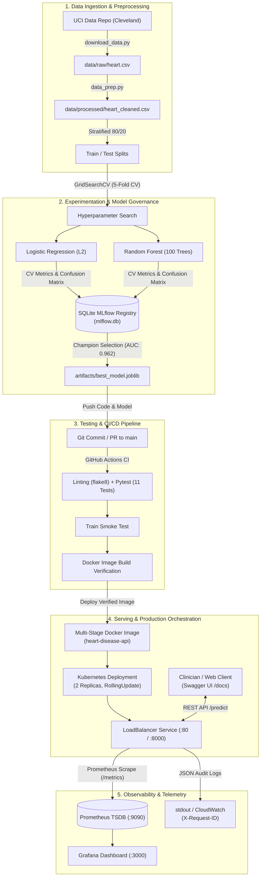

# 🫀 End-to-End Heart Disease MLOps Production Pipeline

[](https://github.com/goelkiran/heart-disease-mlops/actions)
[](https://www.python.org/downloads/)
[](https://www.docker.com/)
[](https://kubernetes.io/)
[](https://mlflow.org/)

**Student Name**: Kiran Kumar  
**Student ID**: `2025AE05377`  
**Course**: Machine Learning Operations (AIML ZG523) — Assignment 01  
**Dataset**: UCI Heart Disease Repository (Cleveland Clinic Database)  

---

## 📌 Executive Architecture & System Topology



---

## 🚀 Quickstart & Reproduction Guide

### 1. Environment Setup (Local Python)
```bash
# Clone the repository
git clone https://github.com/goelkiran/heart-disease-mlops.git
cd heart-disease-mlops

# Create virtual environment and install dependencies
python -m venv venv
# On Windows:
venv\Scripts\activate
# On Linux/macOS:
source venv/bin/activate

pip install -r requirements.txt
```

### 2. End-to-End Model Pipeline Execution
```bash
# Step 1: Download UCI dataset
python src/download_data.py

# Step 2: Clean and validate dataset
python src/data_prep.py

# Step 3: Generate publication EDA visualizations
python src/eda_analysis.py

# Step 4: Run model training, GridSearchCV, and MLflow logging
python src/train.py

# Step 5: Execute comprehensive test suite (11 unit/integration tests)
pytest tests/ -v
```

### 3. Launch MLflow UI
```bash
# Inspect experiment runs, parameters, confusion matrices, and ROC curves
mlflow ui --backend-store-uri sqlite:///mlflow.db --port 5000
```
Open your browser at `http://localhost:5000`.

---

## 🐳 Containerization (Docker)

### Build and Run with Docker
```bash
# Build production multi-stage image
docker build -t heart-disease-api:v1.0.0 .

# Run container locally
docker run -d --name heart-api -p 8000:8000 heart-disease-api:v1.0.0

# Verify healthcheck
curl http://localhost:8000/health
```

### Single-Command Run via Docker Compose
```bash
docker compose up -d
```
Access interactive Swagger UI documentation at: `http://localhost:8000/docs`.

---

## ☸️ Kubernetes Deployment (Minikube / Cloud)

Deploy the multi-replica, self-healing deployment with rolling updates and Prometheus scraping annotations:

```bash
# Apply deployment and services
kubectl apply -f k8s/deployment.yaml
kubectl apply -f k8s/service.yaml

# Check pods and services
kubectl get pods -l app=heart-disease-api
kubectl get svc heart-disease-api-service
```

---

## 📈 Monitoring & Telemetry Stack

Run the integrated API + Prometheus + Grafana monitoring stack:

```bash
cd monitoring
docker compose -f docker-compose.monitoring.yml up -d
```
- **API Swagger Docs**: `http://localhost:8000/docs`
- **Prometheus Metrics Scrape**: `http://localhost:8000/metrics`
- **Prometheus UI**: `http://localhost:9090`
- **Grafana Dashboard**: `http://localhost:3000` *(Login: admin / admin)*

---

## 📊 Sample Inference Request & Response

### Endpoint: `POST /predict`
```bash
curl -X POST "http://localhost:8000/predict" \
     -H "Content-Type: application/json" \
     -d '{
       "age": 60,
       "sex": 1,
       "cp": 4,
       "trestbps": 145,
       "chol": 282,
       "fbs": 0,
       "restecg": 2,
       "thalach": 142,
       "exang": 1,
       "oldpeak": 2.8,
       "slope": 2,
       "ca": 2.0,
       "thal": 7.0
     }'
```

### Response:
```json
{
  "prediction": 1,
  "diagnosis": "Heart Disease Present",
  "probability": 0.8842,
  "risk_level": "High",
  "confidence": 0.8842
}
```

---

## 🏆 Model Benchmark & Evaluation Summary

| Model Architecture | Hyperparameters | 5-Fold CV ROC-AUC | Test Accuracy | Test Precision | Test Recall | Test F1-Score | Test ROC-AUC |
| :--- | :--- | :--- | :--- | :--- | :--- | :--- | :--- |
| **Logistic Regression (L2)** | $C=5.0$, `solver=liblinear` | **0.9029** | **86.89%** | **83.33%** | **89.29%** | **0.8621** | **0.9621** |
| **Random Forest Classifier** | $N=100$, `split=4`, `depth=None` | **0.9073** | **88.52%** | **83.87%** | **92.86%** | **0.8814** | **0.9416** |
