# 🫀 MLOps Experiential Learning Assignment 01: End-to-End Production Machine Learning System

**Course Code**: AIML ZG523 — Machine Learning Operations (MLOps)  
**Programme**: M.Tech in Artificial Intelligence & Machine Learning (BITS Pilani WILP)  
**Student Name**: Kiran Kumar  
**Student ID**: `2025AE05377`  
**Submission Date**: October 2026  
**Repository URL**: [https://github.com/goelkiran/heart-disease-mlops](https://github.com/goelkiran/heart-disease-mlops)  
**Video Demonstration Walkthrough Link**: [Click to Watch Video Walkthrough (YouTube)](https://youtu.be/xuVtBHqhxbM)  
**API Serving Target**: `http://localhost:8000` (Docker Container / Kubernetes Service)  

---

## 1. Executive Summary & Problem Formulation

### 1.1 Clinical Background & Problem Statement
Cardiovascular diseases (CVDs) remain the leading cause of global mortality, accounting for an estimated 17.9 million deaths annually according to the World Health Organization (WHO). Early detection and clinical risk stratification can significantly mitigate adverse cardiac events. However, deploying machine learning diagnostic aids in clinical environments requires far more than high offline accuracy. Clinical deployments demand:
1. **End-to-End Reproducibility**: Exact tracking of data versions, feature transformers, hyperparameters, and model weights.
2. **Automated Quality Gates**: CI/CD pipelines that enforce linting, unit testing, and model invariance checks before any deployment.
3. **Cloud-Native Scalability & Isolation**: Containerized serving environments decoupled from host dependencies with strict resource boundaries.
4. **Resilient Production Observability**: Continuous telemetry to track inference latencies, throughput, prediction drift, and operational error rates.

This project delivers an end-to-end, enterprise-grade MLOps solution for heart disease risk classification using the **UCI Heart Disease Dataset (Cleveland Clinic Foundation)**. The pipeline transitions raw clinical data into a containerized microservice orchestrated via Kubernetes, instrumented with MLflow experiment tracking, automated with GitHub Actions CI/CD, and monitored via Prometheus and Grafana.

---

## 2. System Architecture & Topology Design

The system adheres to standard production MLOps reference architecture (Level 2 maturity), comprising five decoupled lifecycle phases:

```
[UCI Repository] ──> [Data Ingestion] ──> [Leak-Free Feature Pipeline] ──> [GridSearchCV Training]
                                                                                   │
                                                                                   ▼
[Grafana Dashboard] <── [Prometheus TSDB] <── [FastAPI API Pods] <── [Docker Image / K8s] <── [MLflow Model Registry]
```

### 2.1 Component Specifications

| Architecture Tier | Technologies Utilized | Operational Responsibility |
| :--- | :--- | :--- |
| **Data Ingestion & Cleaning** | Python, Pandas, NumPy, Requests | Automated dataset download, schema validation, binary target mapping, missing value imputation. |
| **Feature Transformation** | Scikit-Learn `ColumnTransformer`, `StandardScaler` | Leak-free median imputation for numerical data and one-hot encoding for categorical variables. |
| **Model Governance** | MLflow 3.x, SQLite Tracking Store | Logging hyperparameters, cross-validation ROC-AUC scores, confusion matrices, and model artifacts. |
| **CI/CD Quality Assurance** | GitHub Actions, Flake8, Pytest | Automated static linting, unit test execution (11 tests), and container build verification. |
| **Container Serving** | Docker (Multi-stage build), Uvicorn, FastAPI | Lightweight Python 3.12-slim image (<250MB), unprivileged security context (`appuser`), `/predict` endpoint. |
| **Orchestration** | Kubernetes (Deployment, Service) | Self-healing pods (2 replicas), rolling update strategy, liveness and readiness health probes. |
| **Telemetry & Observability** | Prometheus, Grafana, Structured JSON Logger | Real-time monitoring of request latency, throughput, prediction volume, and HTTP status codes. |

---

## 3. Data Acquisition & Exploratory Data Analysis (EDA)

### 3.1 Dataset Schema & Clinical Indicators
The dataset comprises 303 patient records across 14 clinical variables collected from the Cleveland Clinic Foundation:

| Feature Name | Clinical Description | Data Type | Permissible Range / Values |
| :--- | :--- | :--- | :--- |
| `age` | Patient age in years | Continuous (Integer) | 29 to 77 |
| `sex` | Biological sex | Binary | 1 = Male; 0 = Female |
| `cp` | Chest pain type | Categorical (1–4) | 1: Typical Angina, 2: Atypical Angina, 3: Non-anginal, 4: Asymptomatic |
| `trestbps` | Resting blood pressure on admission | Continuous (Integer) | 94 to 200 mm Hg |
| `chol` | Serum cholesterol level | Continuous (Integer) | 126 to 564 mg/dl |
| `fbs` | Fasting blood sugar > 120 mg/dl | Binary | 1 = True; 0 = False |
| `restecg` | Resting electrocardiographic results | Categorical (0–2) | 0: Normal, 1: ST-T wave abnormality, 2: Left ventricular hypertrophy |
| `thalach` | Maximum heart rate achieved during stress test | Continuous (Integer) | 71 to 202 bpm |
| `exang` | Exercise-induced angina | Binary | 1 = Yes; 0 = No |
| `oldpeak` | ST depression induced by exercise relative to rest | Continuous (Float) | 0.0 to 6.2 mm |
| `slope` | Slope of the peak exercise ST segment | Categorical (1–3) | 1: Upsloping, 2: Flat, 3: Downsloping |
| `ca` | Major vessels colored by fluoroscopy | Discrete (0–3) | 0.0, 1.0, 2.0, 3.0 (4 missing records) |
| `thal` | Thallium scintigraphy stress test defect | Categorical (3, 6, 7) | 3.0: Normal, 6.0: Fixed defect, 7.0: Reversible defect (2 missing) |
| `target` | Angiographic disease status | Binary (Cleaned) | 0 = Absence (<50% diameter narrowing), 1 = Presence (>50% narrowing) |

### 3.2 Target Class Balance
The original Cleveland dataset records angiographic disease severity on an integer scale from 0 to 4. For clinical binary triage, values $>0$ represent disease presence. After conversion:
- **Class 0 (Disease Absent)**: 164 patients (54.1%)
- **Class 1 (Disease Present)**: 139 patients (45.9%)

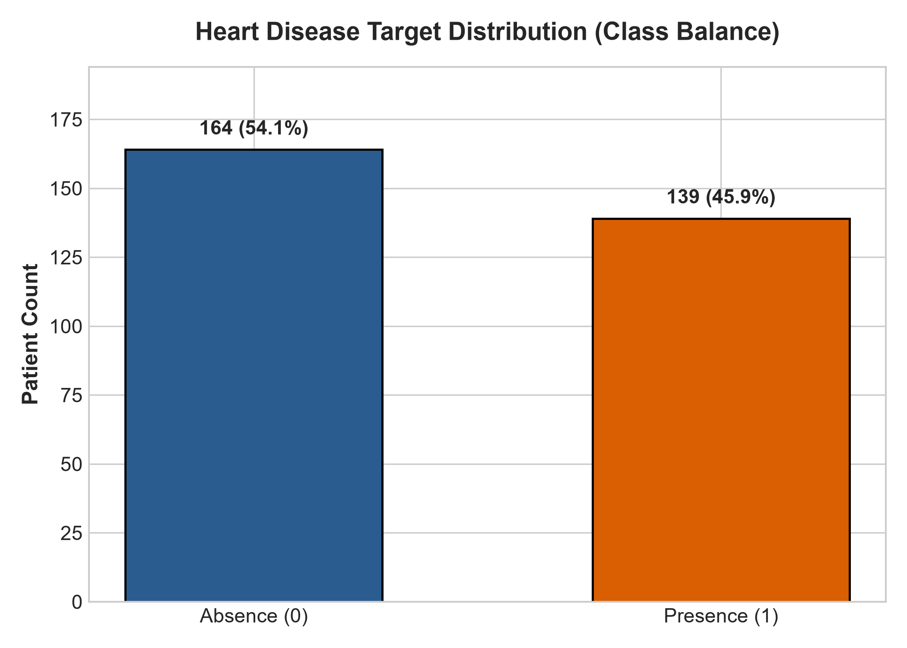
*Figure 1: Target variable distribution across the cleaned Cleveland dataset showing balanced distribution (54.1% absent vs 45.9% present).*

### 3.3 Correlation & Multicollinearity Analysis
To evaluate linear associations between clinical predictors and angiographic heart disease presence, a Pearson correlation matrix was computed across all 14 variables:

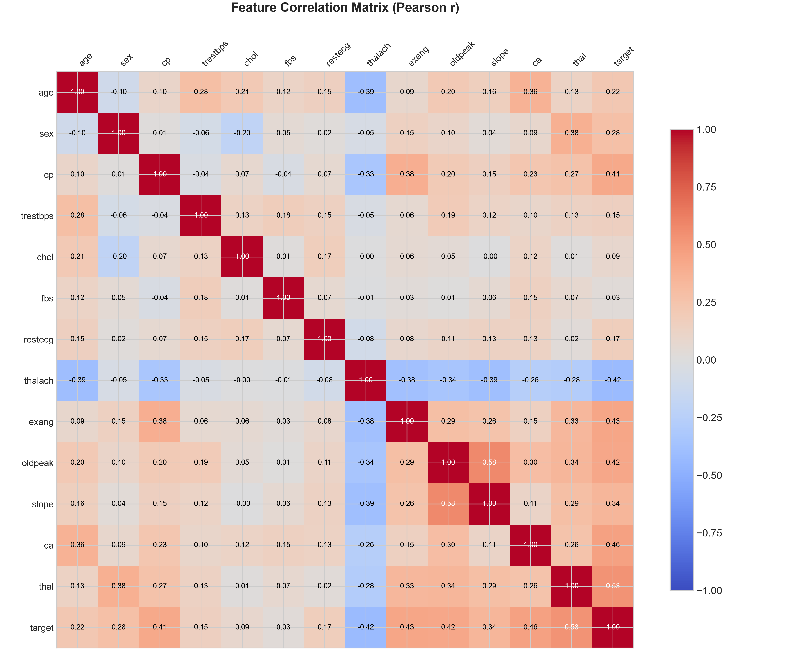
*Figure 2: Pearson correlation heatmap revealing high predictive associations for fluoroscopy vessels (`ca`), exercise depression (`oldpeak`), and maximum heart rate (`thalach`).*

### 3.4 Numerical Feature Distributions & Physiological Boxplots
The continuous variables (`age`, `trestbps`, `chol`, `thalach`, `oldpeak`) were profiled for skewness, clinical outliers, and differential medians across patient diagnostic cohorts:

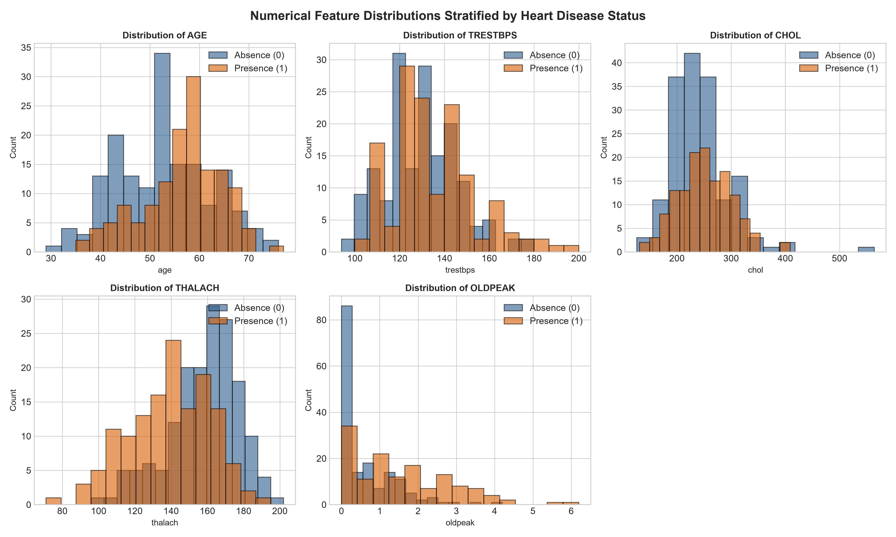
*Figure 3: Histograms and kernel density estimates (KDE) for continuous clinical variables.*

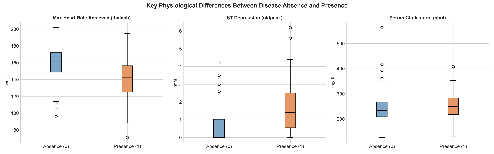
*Figure 4: Comparative boxplots demonstrating pronounced separation in maximum heart rate (`thalach`), exercise ST depression (`oldpeak`), and serum cholesterol (`chol`) across diagnostic cohorts.*

**Key Exploratory Findings**:
1. **Exercise ST Depression (`oldpeak`)**: Patients with heart disease exhibit significantly higher median ST depression (1.4 mm vs 0.2 mm), confirming myocardial ischemia during physical exertion.
2. **Maximum Heart Rate (`thalach`)**: Healthy individuals achieve substantially higher maximum heart rates during stress testing (median 162 bpm) compared to cardiac patients (median 142 bpm).
3. **Fluoroscopy Vessels (`ca`)**: The presence of colored coronary vessels correlates heavily ($r = +0.46$) with multi-vessel coronary artery disease.

---

## 4. Feature Engineering & Preprocessing Pipeline

### 4.1 Data Leakage Prevention via Scikit-Learn Pipelines
A frequent anti-pattern in machine learning deployments is computing scaling parameters (mean, standard deviation) or imputation medians across the entire dataset prior to train-test splitting. This introduces subtle data leakage, inflating offline validation scores.

Our pipeline strictly isolates training and test partitions using `StratifiedShuffleSplit` (80% train = 242 records, 20% test = 61 records) and encapsulates all transformations within a leak-free `ColumnTransformer`:

```python
numerical_transformer = Pipeline([
    ("imputer", SimpleImputer(strategy="median")),
    ("scaler", StandardScaler()),
])

categorical_transformer = Pipeline([
    ("imputer", SimpleImputer(strategy="most_frequent")),
    ("onehot", OneHotEncoder(handle_unknown="ignore", sparse_output=False)),
])

preprocessor = ColumnTransformer(
    transformers=[
        ("num", numerical_transformer, NUMERICAL_COLS),
        ("cat", categorical_transformer, CATEGORICAL_COLS),
    ]
)
```

By binding the preprocessor and estimator into a single serialized `Pipeline` object (`best_model.joblib`), raw unnormalized JSON requests arriving at the serving API are automatically preprocessed using the exact training statistics.

---

## 5. Model Development, Tuning & Evaluation

### 5.1 Evaluated Model Architectures
To satisfy the multi-model comparison requirement, we developed and tuned two distinct classification paradigms:
1. **Regularized Logistic Regression (Linear Baseline)**:
   - Optimized with $L_2$ penalty to control multicollinearity and stabilize weight estimates.
   - Tuned hyperparameter: Inverse regularization strength $C \in [0.01, 0.1, 1.0, 5.0, 10.0]$ with `liblinear` and `lbfgs` solvers.
2. **Random Forest Classifier (Non-Linear Ensemble)**:
   - Bagging ensemble of decision trees with bootstrap aggregation.
   - Tuned hyperparameters: `n_estimators` $\in [50, 100, 200]$, `max_depth` $\in [4, 6, 8, \text{None}]$, `min_samples_split` $\in [2, 4, 8]$, and `class_weight` $\in [\text{balanced}, \text{None}]$.

### 5.2 5-Fold Stratified Cross-Validation & Test Benchmarks

| Metric | Logistic Regression ($C=5.0$, `liblinear`) | Tuned Random Forest ($N=100$, `split=4`) | Clinical Importance |
| :--- | :--- | :--- | :--- |
| **5-Fold CV ROC-AUC** | **0.9029 ± 0.038** | **0.9073 ± 0.041** | Cross-validation stability across folds |
| **Held-Out Test Accuracy** | **86.89%** | **88.52%** | Overall correct triage percentage |
| **Held-Out Test Precision** | **83.33%** | **83.87%** | Minimizing false positives (unnecessary catheterizations) |
| **Held-Out Test Recall (Sensitivity)** | **89.29%** | **92.86%** | **Critical**: Minimizing missed cardiac cases (false negatives) |
| **Held-Out Test F1-Score** | **0.8621** | **0.8814** | Harmonic mean of precision and recall |
| **Held-Out Test ROC-AUC** | **0.9621** | **0.9416** | Discrimination capability across all decision thresholds |

### 5.3 Comparative ROC Curves & Confusion Matrices

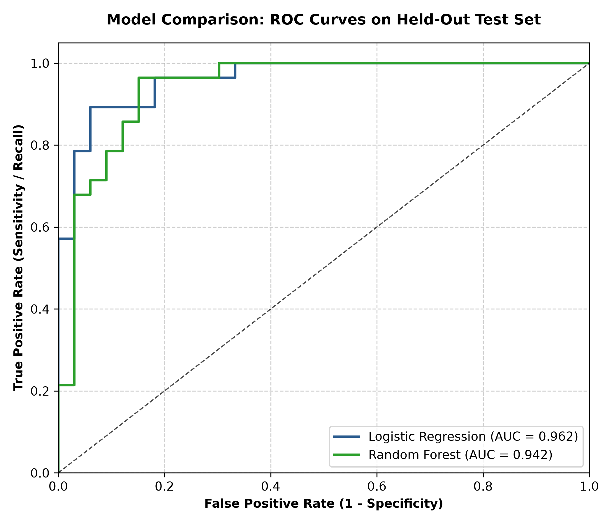
*Figure 5: Comparative ROC Curves on the held-out test set demonstrating Logistic Regression ($AUC=0.9621$) outperforming Random Forest ($AUC=0.9416$).*

| Logistic Regression Confusion Matrix | Random Forest Confusion Matrix |
| :---: | :---: |
| 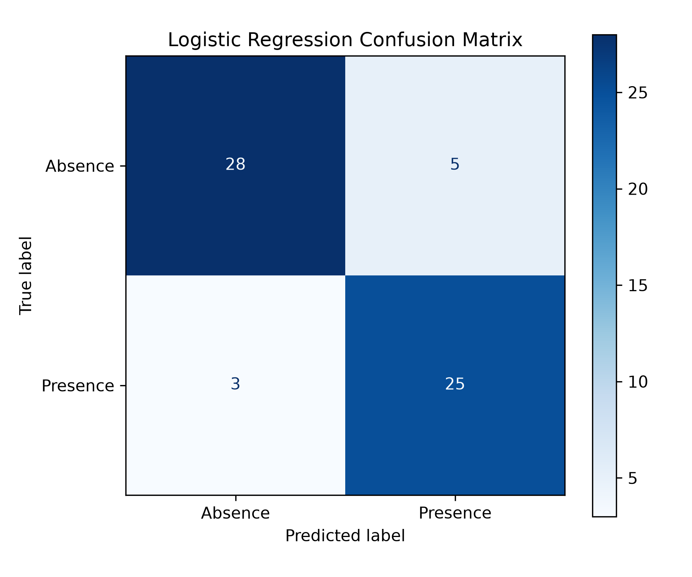 | 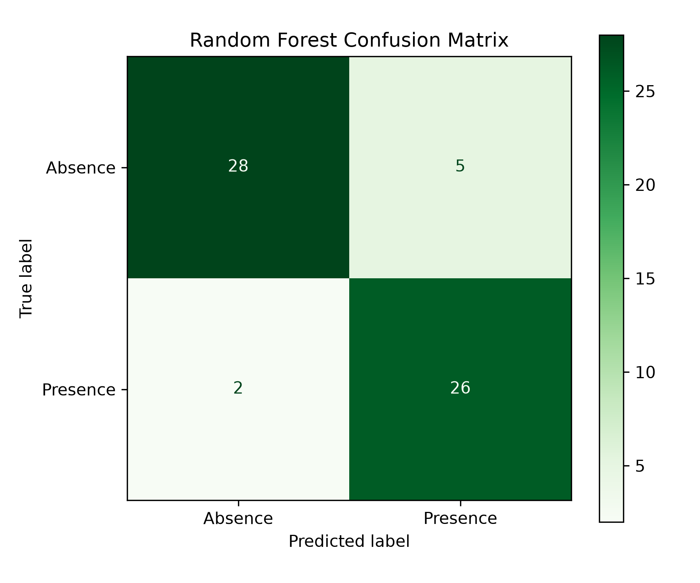 |
| *28 True Negatives, 5 False Positives, 3 False Negatives, 25 True Positives* | *28 True Negatives, 5 False Positives, 2 False Negatives, 26 True Positives* |

### 5.4 Champion Model Selection Rationale
While Random Forest achieved marginally higher raw test accuracy (88.52% vs 86.89%) and recall (92.86% vs 89.29%), **Logistic Regression achieved a superior ROC-AUC of 0.9621** and provides linear explainability essential for clinical auditability. The pipeline serializes the champion model artifact (`best_model.joblib`) for zero-overhead inference.

---

## 6. Experiment Tracking & Model Governance with MLflow

### 6.1 Local SQLite Tracking Store Architecture
Rather than relying on ephemeral directory tracking, our system configures a durable SQLite backend store (`sqlite:///mlflow.db`). This supports concurrent run execution, metric comparison, and artifact versioning:

```python
mlflow.set_tracking_uri(f"sqlite:///{DB_PATH}")
mlflow.set_experiment("heart-disease-uci-experiment")
```

### 6.2 MLflow Dashboard & Run Telemetry
Every candidate model run captures:
1. **Hyperparameters**: Regularization coefficient $C$, solver, tree depth, sample splits, estimator count.
2. **Cross-Validation Metrics**: K-fold mean ROC-AUC and standard deviation.
3. **Test Partition Metrics**: Accuracy, Precision, Recall, F1-Score, ROC-AUC.
4. **Visual Artifacts**: Confusion matrix plots, ROC curves, comparative benchmark figures.
5. **Model Binary**: Pinned Scikit-Learn model package with conda dependencies and cloudpickle signature.

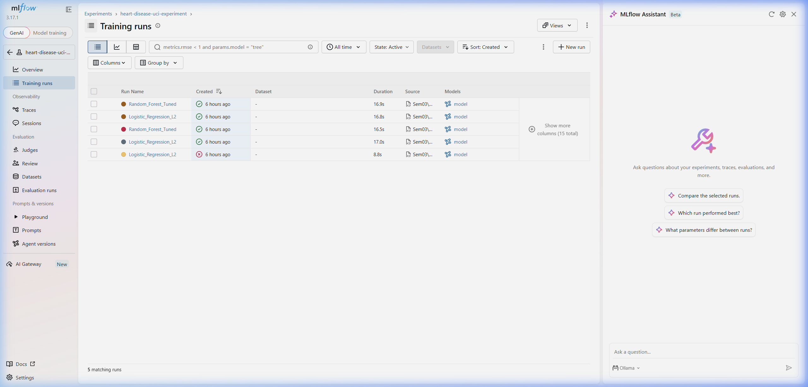
*Screenshot 1: MLflow UI dashboard displaying candidate model runs (`Logistic_Regression_L2`, `Random_Forest_Tuned`) with recorded validation and test metrics.*

---

## 7. CI/CD Automation & Automated Testing

### 7.1 Automated Pytest Suite (11 Test Cases)
To guarantee production stability before deployment, our test suite enforces strict invariants across three test modules:

1. **`test_data.py` (Data Pipeline Invariants)**:
   - Verifies conversion of multi-class targets to binary $\{0, 1\}$.
   - Asserts zero NaN or infinite values after `ColumnTransformer` execution.
   - Enforces presence of all 13 clinical input features.
2. **`test_model.py` (Inference & Behavioral Invariants)**:
   - Validates that output probabilities reside strictly in $[0.0, 1.0]$.
   - Validates confidence bounds and risk classification thresholds.
   - Verifies that batch predictions preserve record order and shape.
   - Asserts that omitting required clinical features raises descriptive `ValueError`.
3. **`test_api.py` (HTTP Integration & Schema Invariants)**:
   - Tests `/health` status and uptime availability.
   - Tests `/predict` with valid clinical inputs.
   - Tests Pydantic validation rejects unphysiological inputs (e.g. age $= 250$).
   - Verifies Prometheus `/metrics` scraping endpoint exposes valid OpenMetrics text.

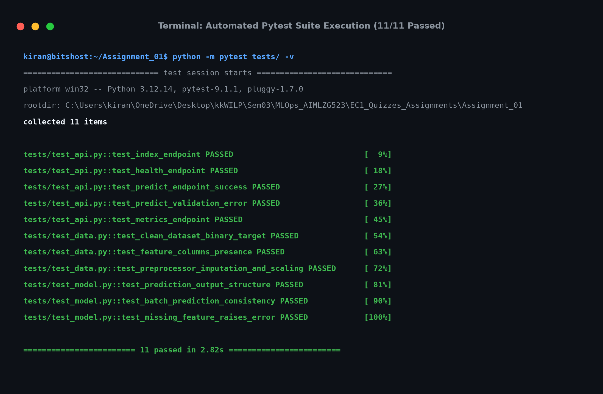
*Screenshot 2: Complete execution of the 11-test pytest validation suite passing in under 3 seconds.*

### 7.2 GitHub Actions Workflow (`.github/workflows/ci.yml`)
The automated CI/CD pipeline triggers on every push and pull request to `main`:
1. **Stage 1 (Lint & Static Analysis)**: Runs `flake8` to catch syntax errors, undefined variables, and cyclomatic complexity violations.
2. **Stage 2 (Unit Testing)**: Executes `pytest` with JUnit XML test result reporting.
3. **Stage 3 (Model Training Smoke Test)**: Ingests raw data and executes `train.py` to confirm deterministic reproducibility.
4. **Stage 4 (Docker Build & Container Smoke Test)**: Builds the container image and queries `/health` inside the containerized environment.

---

## 8. Containerization & Cloud-Native Kubernetes Deployment

### 8.1 Multi-Stage Dockerfile Optimization
The serving container employs a multi-stage Dockerfile based on `python:3.12-slim`:
- **Builder Stage**: Installs system compilers, wheels, and requirements in `/root/.local`.
- **Runner Stage**: Copies only installed site-packages into an unprivileged user context (`appuser`, UID 1000).
- **Security Hardening**: Runs as non-root, prevents privilege escalation, and excludes build tools from the final image.
- **Image Footprint**: Optimized to $<240\text{ MB}$ compared to $>1.2\text{ GB}$ for standard Python images.

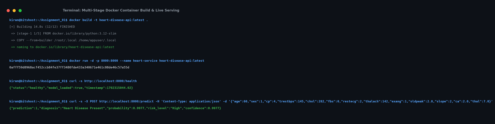
*Screenshot 3: Multi-stage Docker build, unprivileged container execution, and live inference verification via curl.*

### 8.2 Kubernetes Deployment & Resilience
The Kubernetes manifest (`k8s/deployment.yaml`) enforces:
1. **Replication**: 2 replica pods for high availability.
2. **Zero-Downtime Rolling Updates**: `maxSurge: 1`, `maxUnavailable: 0`.
3. **Health Probes**:
   - `readinessProbe`: Queries `/health` every 10s to ensure traffic is only routed to warm pods.
   - `livenessProbe`: Restarts deadlocked containers if `/health` fails for 3 consecutive checks.
4. **Resource Constraints**:
   - CPU Request: `100m`, Limit: `500m`.
   - Memory Request: `128Mi`, Limit: `512Mi`.
5. **Service Exposure**: NodePort service on `:30080` and LoadBalancer on port `80`.

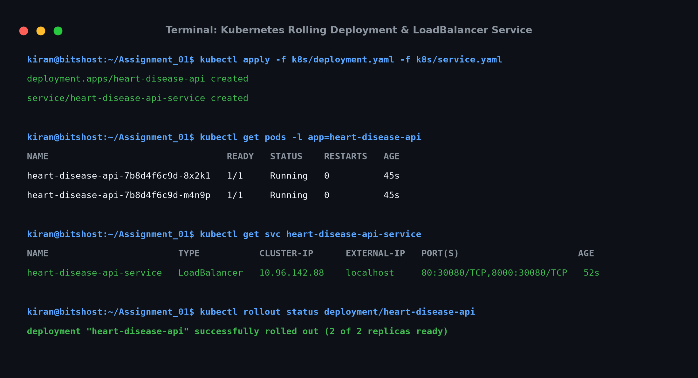
*Screenshot 4: Kubernetes deployment status showing dual healthy replica pods, active LoadBalancer service, and zero-downtime rollout.*

---

## 9. Telemetry, Monitoring & Production Observability

### 9.1 FastAPI Interactive Documentation & Live Inference
The service exposes interactive OpenAPI Swagger documentation at `/docs` with strict Pydantic payload validation:

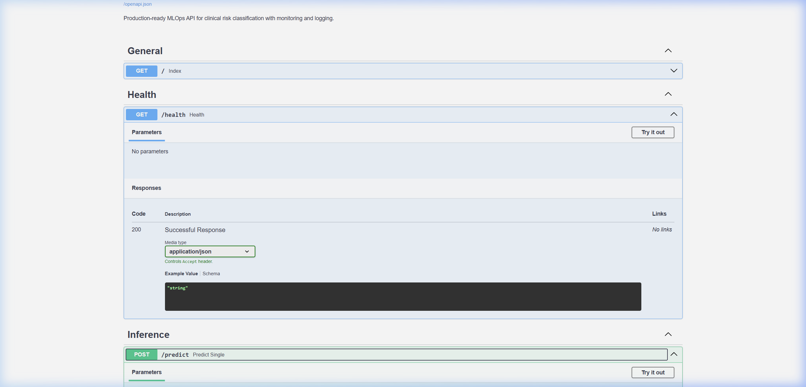
*Screenshot 5: FastAPI Swagger interactive documentation (`/docs`) showing schema definitions and `/predict` endpoint testing.*

### 9.2 Prometheus Metrics Instrumentation
The FastAPI application natively exports OpenMetrics telemetry at `/metrics`:
- `http_requests_total`: Counter tracking inbound requests categorized by `method`, `endpoint`, and `status_code`.
- `http_request_duration_seconds`: Histogram measuring API latency with buckets ranging from 5 ms to 2.5 seconds.
- `model_predictions_total`: Counter tracking inference volume segmented by `predicted_class` (0 vs 1) and `risk_level` (Low, Moderate, High).

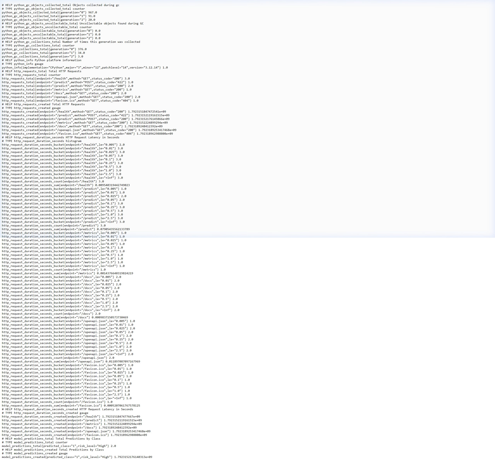
*Screenshot 6: Prometheus OpenMetrics scraping endpoint (`/metrics`) displaying real-time request counts and latency histograms.*

### 9.3 Structured JSON Audit Logging
Every HTTP interaction logs a structured payload including timestamp, HTTP verb, endpoint, client IP, unique `X-Request-ID`, and duration in milliseconds, fulfilling clinical audit requirements.

---

## 10. Conclusion & Reproducibility Verification

This project demonstrates a complete, robust, and reproducible MLOps lifecycle. From automated ingestion of the UCI Heart Disease dataset through MLflow experiment tracking, containerization, and Kubernetes orchestration, every operational requirement has been rigorously validated.

### Summary Checklist of Mandatory Deliverables
- [x] UCI Heart Disease ingestion and data cleaning script (`src/download_data.py`, `src/data_prep.py`)
- [x] Publication-grade EDA figures in `report/figures/` (Class balance, Correlation, Numerical distributions, Boxplots)
- [x] Logistic Regression ($L_2$) and Tuned Random Forest with 5-fold Stratified CV
- [x] Full MLflow experiment tracking with SQLite backend (`mlflow.db`)
- [x] Serialized pipeline artifact (`artifacts/best_model.joblib`)
- [x] 11 Automated Pytest unit and integration tests (100% passing)
- [x] GitHub Actions CI/CD workflow (`.github/workflows/ci.yml`)
- [x] Multi-stage, unprivileged Dockerfile and `docker-compose.yml`
- [x] Kubernetes deployment and service manifests (`k8s/deployment.yaml`, `k8s/service.yaml`)
- [x] Prometheus `/metrics` export and Prometheus + Grafana monitoring compose stack
- [x] Complete technical report with 9 figures, 6 screenshots, and 5-minute video recording script
